<div align="center">

<a href="https://cccloud.dev">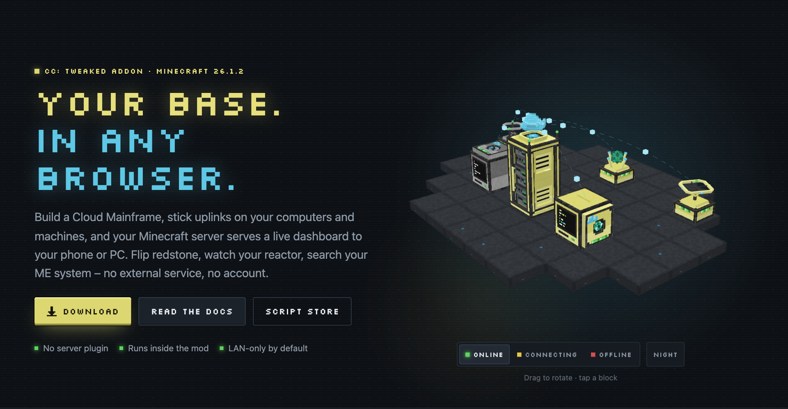</a>

**[Website](https://cccloud.dev)** &nbsp;·&nbsp; **[Docs](https://cccloud.dev/en/docs/)** &nbsp;·&nbsp; **[Download](https://cccloud.dev/en/download/)** &nbsp;·&nbsp; **[Script Store](https://cccloud.dev/en/store/)** &nbsp;·&nbsp; **[Discord](https://discord.gg/4fnQcvbzg6)**

[](https://cccloud.dev/en/download/)
[](https://neoforged.net)
[](https://modrinth.com/mod/cc-tweaked)
[](LICENSE)
[](https://discord.gg/4fnQcvbzg6)

</div>

**Your whole Minecraft base, always in your pocket.** Build a **Cloud Mainframe**, attach **Uplinks** to your
computers and machines, open the dashboard on your phone or PC – and flip switches, watch your reactor, search your ME
system or start a craft from anywhere in your home network. No external service, no account, no relay: the dashboard
is served by the mod itself.

> [!IMPORTANT]
> CC: Cloud is an addon: it needs **[CC: Tweaked](https://modrinth.com/mod/cc-tweaked) 1.120.0+** installed next to
> it, on the client and the server. For Minecraft 26.1.2 CC: Tweaked is published on Modrinth only – download it there
> and put both jars into your `mods/` folder (also when you use the CurseForge app).

<p align="center">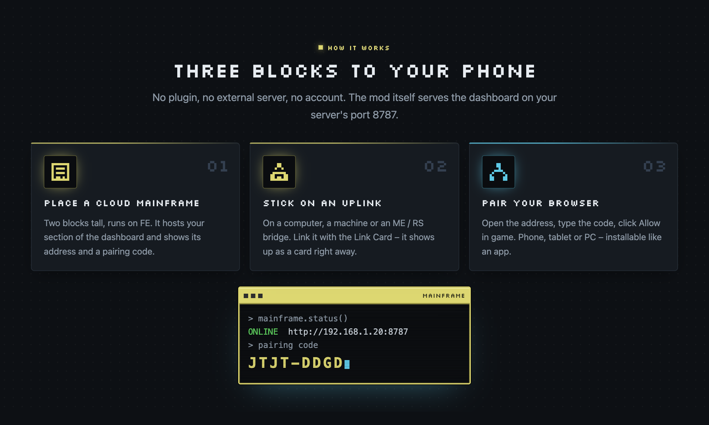</p>

## Features

<a href="https://cccloud.dev/en/features/">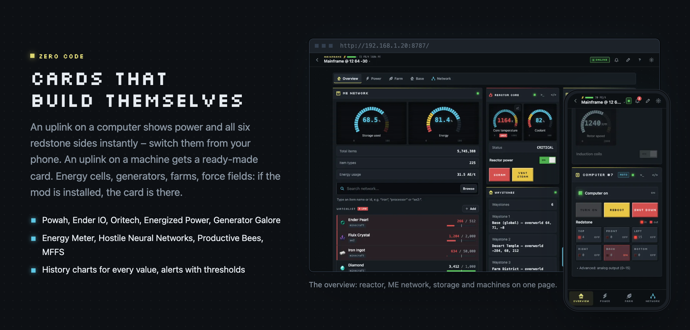</a>
<a href="https://cccloud.dev/en/features/">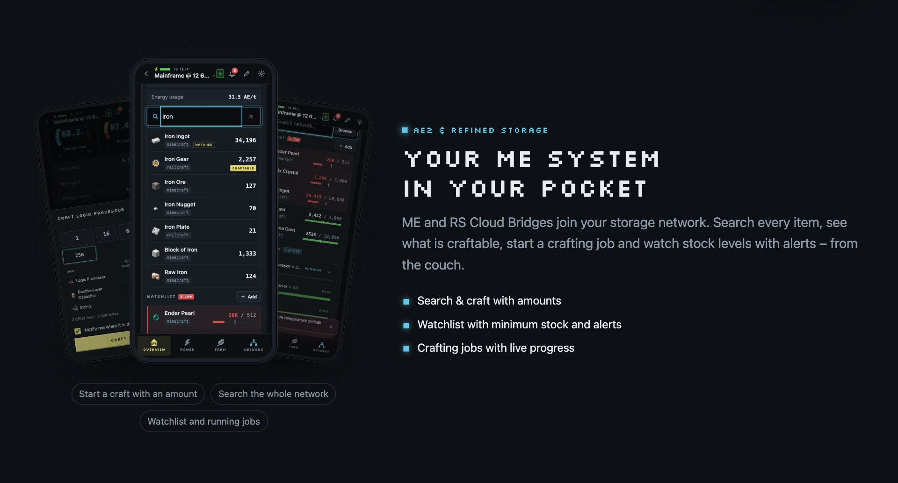</a>
<a href="https://cccloud.dev/en/features/">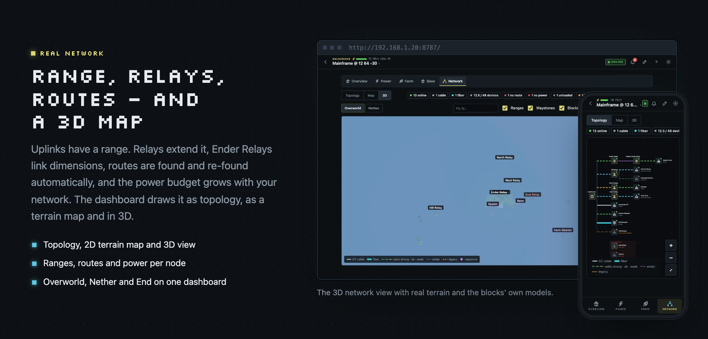</a>
<a href="https://cccloud.dev/en/features/">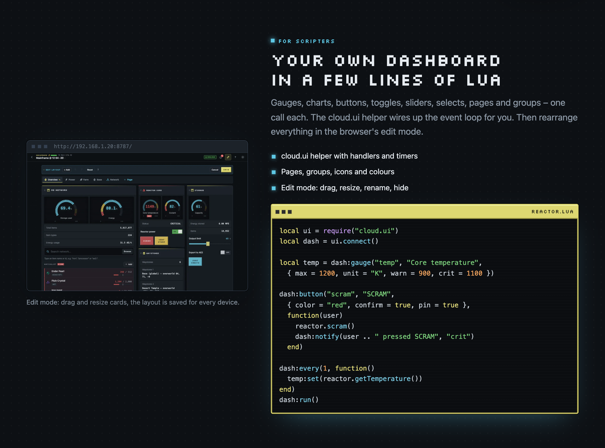</a>
<a href="https://cccloud.dev/en/features/">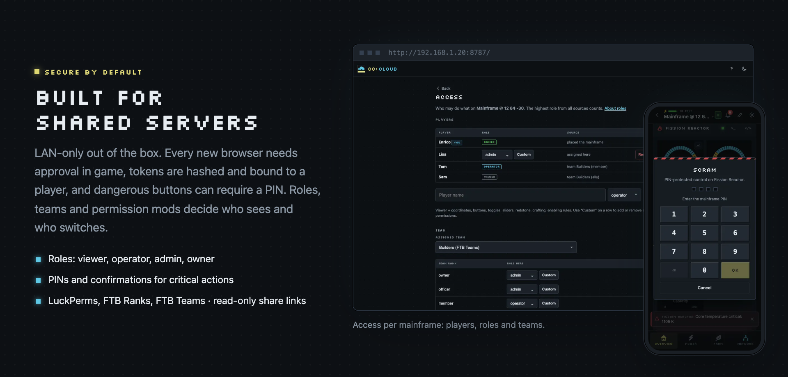</a>

| | |
|---|---|
| 🖥️ **Zero-code cards** | An uplink on a computer shows power and all six redstone sides instantly. An uplink on a machine shows a ready-made card – for [40+ mods](docs/COMPAT.md) of All the Mods 11 (Powah, Ender IO, Oritech, Mystical Agriculture, Railcraft, Productive Bees, …), plus generic Energy and Tank cards for everything else. Machines behind CC wired modems get cards too. |
| 💡 **Redstone devices** | Cloud Switch, Button, Lamp and Sensor: place, link with the Link Card, done – switch lamps and doors from your phone, get a push when someone steps into a room. |
| 🔎 **Cloud Probe** | Reads machines whose sides are all built in, from up to 8 blocks away – deliberately expensive, so it stays special. |
| 📦 **AE2 & Refined Storage** | Browse and search the whole network, item details with history, craft previews with missing items, CPUs and jobs, auto-stock rules that craft when stock runs low. |
| 🧩 **Custom dashboards** | A Lua API (`cloud.button`, `cloud.gauge`, `cloud.chart`, pages, groups …) and the `cloud.ui` helper. Arrange the live cards in the layout editor – drag, resize, styles, undo. |
| ⚙️ **Automation** | No-code rules (when → if → then), scenes (one button, many actions), schedules, push notifications to Discord, ntfy or webhooks, long-term history with CSV export. |
| 📈 **Production stats** | Items and energy per minute for AE2 and RS – and "what is eating my iron". |
| 🔌 **Public API** | Opt-in REST API with scoped keys for bots and Home Assistant (off by default). |
| ⌨️ **For scripters** | A browser terminal for any computer, a Lua editor with a file tree, and the community **[Script Store](https://cccloud.dev/en/store/)** with signed, verified installs. |
| 📡 **Real network** | Ranges, relays, Ender Relays across dimensions, CC cables and fiber, mainframe upgrades up to the Quantum Core, topology, 2D map and a 3D view of your base. |
| 🔐 **Secure by default** | LAN-only, in-game approval for every new browser, roles with fine-grained permissions, PINs for critical controls, LuckPerms / FTB Ranks / FTB Teams, read-only share links. |
| 🎮 **In-game** | Mainframe and uplink screens in the CC: Tweaked look, Cloud Tablet, Cloud Display, Cloud Analyzer, a GuideME handbook, JEI, Jade and JourneyMap support. |
| 🧭 **Docs built in** | Bilingual (EN/DE) documentation at `/docs` on your own dashboard – works offline, shows your modpack's real recipes. |

<p align="center"><a href="https://cccloud.dev/en/docs/mods/">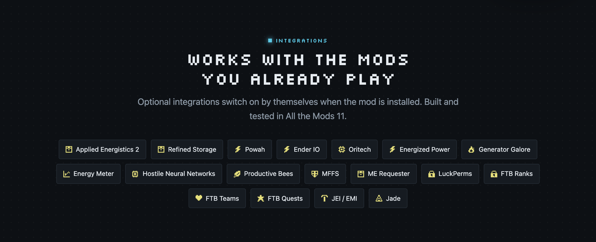</a></p>

<p align="center"><a href="https://cccloud.dev/en/store/">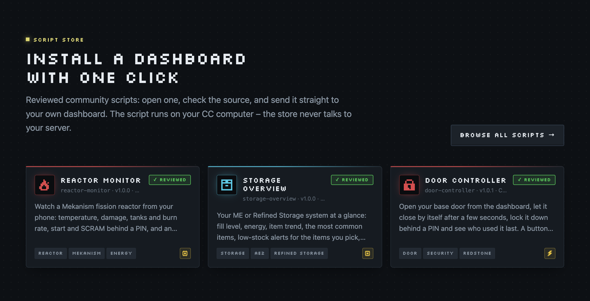</a></p>

<p align="center"><a href="https://discord.gg/4fnQcvbzg6">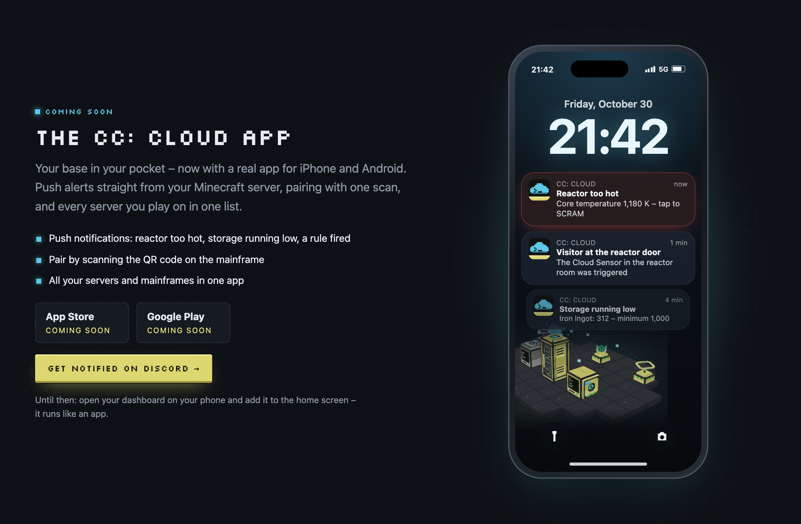</a></p>

## Blocks

<p align="center">
  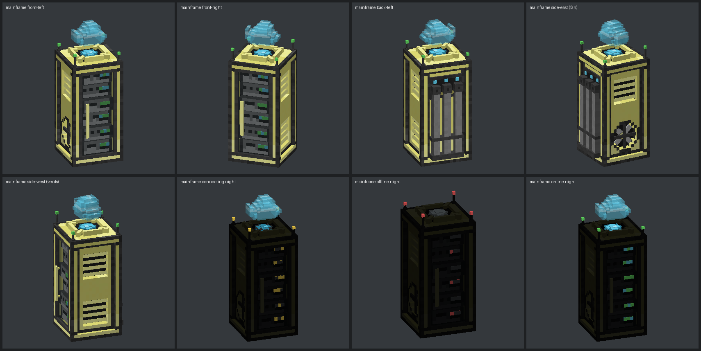
</p>

| Block | What it does |
|---|---|
| **Cloud Mainframe** | 2 blocks tall. The heart of your network: hosts your dashboard section, needs FE power, has a redstone kill switch and a hologram that tells you its state. |
| **Cloud Uplink / Advanced Cloud Uplink** | A flat plate like a CC modem. Stick it on a computer (Lua or automatic card) or directly on a machine. |
| **ME / RS Cloud Bridge** | Joins your AE2 or Refined Storage network (only registered when the mod is installed). |
| **Cloud Relay / Advanced / Ender Relay** | Extend the range of your network; Ender Relays link dimensions. |
| **Cloud Switch / Button / Lamp / Sensor** | Small redstone devices without a computer: a lever, a button, a dimmable lamp and a signal reader. |
| **Cloud Probe** | Reads a machine a few blocks away when every side of it is built in. |

<p align="center">
  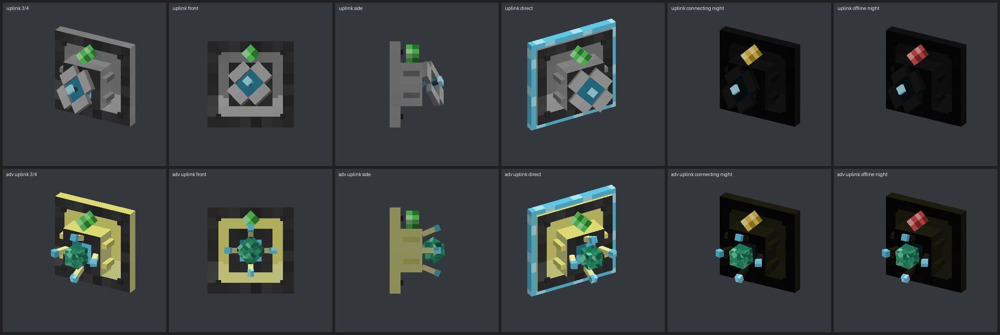
  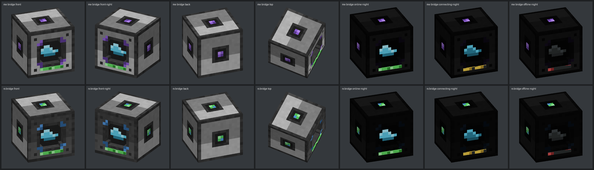
  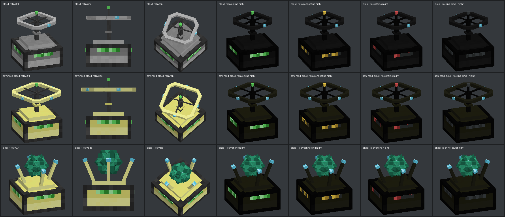
  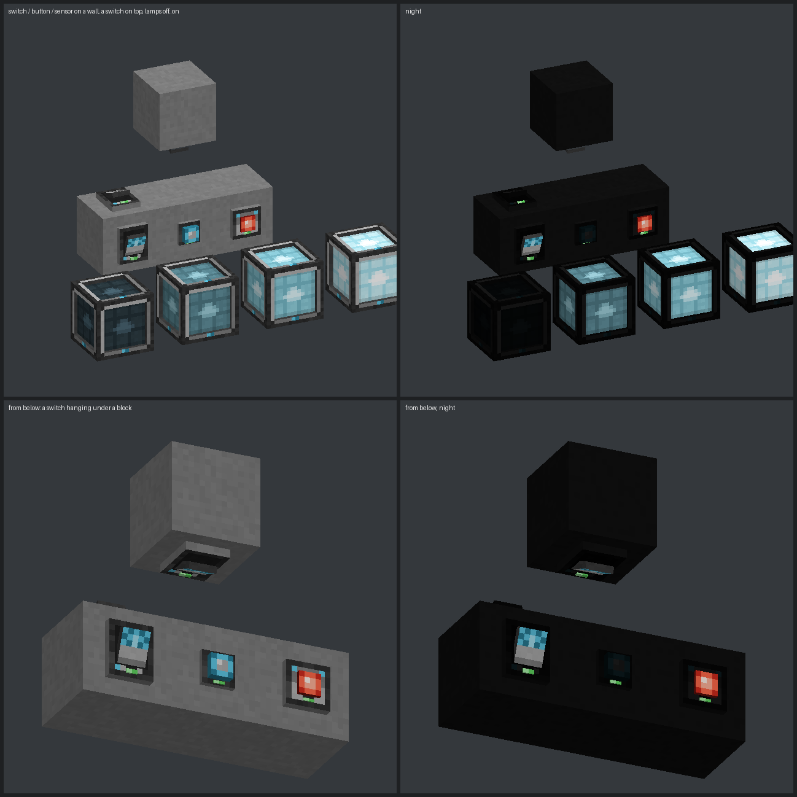
</p>

## Quick start

1. Install **[CC: Tweaked](https://modrinth.com/mod/cc-tweaked)** and **CC: Cloud** (client and server) – from
   [the download page](https://cccloud.dev/en/download/) or the [releases](https://github.com/enricofranke/cc-cloud/releases).
2. Place a **Cloud Mainframe** and give it power (any FE source).
3. Place a computer, stick a **Cloud Uplink** on it, and link it with the **Link Card** (right-click the mainframe, then the uplink).
4. Right-click the mainframe: it shows the dashboard address (e.g. `http://192.168.1.20:8787`) and a pairing code.
5. Open the address in your browser, enter the code and click **Allow** in the in-game chat or screen. Done – your
   computer shows up as a card.

Want your own dashboard? Run `cloud-demo` on the computer, or start from this:

```lua
local ui = require("cloud.ui")
local dash = ui.connect()

local temp = dash:gauge("temp", "Core temperature", { max = 1200, unit = "K", warn = 900, crit = 1100 })
dash:button("scram", "SCRAM", { color = "red", confirm = true, pin = true }, function(user)
  reactor.scram()
  dash:notify(user .. " pressed SCRAM", "crit")
end)

dash:every(1, function() temp:set(reactor.getTemperature()) end)
dash:run()
```

Full reference: [cccloud.dev/en/docs](https://cccloud.dev/en/docs/), `/docs` on your own dashboard, or `help cloud` in game.

## Hosting & security

- The dashboard listens on port **8787** and only accepts **LAN addresses** by default (Tailscale counts as private).
- Internet access is opt-in (`webAllowInternet = true` in `cccloud-server.toml`). Use TLS or a reverse proxy / tunnel – see [`docs/HOSTING.md`](docs/HOSTING.md).
- Every new browser needs in-game approval by a player with the right role. Tokens are hashed, bound to a player and re-checked live (bans, role changes).
- Server permissions via the NeoForge PermissionAPI (`cccloud.*` nodes) – works with LuckPerms and FTB Ranks.
- Threat model and reviews: [`docs/SECURITY.md`](docs/SECURITY.md) · Found a vulnerability? See [SECURITY.md](SECURITY.md) – please report privately.

## Performance & stability

Measured with the mod's own benchmarks in a real NeoForge server (10-core desktop CPU; a Minecraft tick has 50 ms):

| Scenario | Result |
|---|---|
| One mainframe, 500 devices, 10 open dashboards | **0.5–1 ms** per tick |
| Stress test: 1,500 devices on 11 mainframes, 100 rules, 50 browsers, ~5,500 value changes/s | **1.6 ms** per tick on average (was 6.4 ms before the scaling work) |
| Soak test: 6 hours, 20 browsers at once | 20 TPS throughout, **0 errors**, no memory growth |
| Dashboard of a 500-device base | first card after **0.3 s**, 12 messages/s per browser, 112 KB snapshot (compressed) |
| 3D view of a whole base (536 sections) | loads in **2 s**, reopens in under 1 s |

How it is measured, the remaining limits and the server settings for big bases: [`docs/SPEC.md` → Scaling](docs/SPEC.md) and
[Big servers](https://cccloud.dev/en/docs/security/#big-servers).

## Compatibility

- Minecraft **26.1.2**, NeoForge **26.1.2.109+**, CC: Tweaked **1.120.0+**, Java **25**
- Built and tested against **All the Mods 11** (0.12.0-beta) with ~290 mods, and with 500 devices on one mainframe.
- Optional integrations activate automatically when the mod is present; nothing breaks without them.

## Community & contributing

- Help, ideas and showcases: the **[Discord](https://discord.gg/4fnQcvbzg6)**.
- Bugs and feature requests: [issues](https://github.com/enricofranke/cc-cloud/issues/new/choose).
- Code, docs and translations: see [CONTRIBUTING.md](CONTRIBUTING.md) and the [code of conduct](CODE_OF_CONDUCT.md).
- Script Store scripts: a pull request to [cc-cloud-scripts](https://github.com/enricofranke/cc-cloud-scripts) ([how to submit](https://github.com/enricofranke/cc-cloud-scripts/blob/main/CONTRIBUTING.md)).

<details>
<summary><b>Development</b></summary>

```bash
./gradlew build                     # mod jar in build/libs/
./gradlew runClient                 # dev client
./gradlew runGameTestServer         # GameTests (add -PstorageMods -PintegrationMods for AE2/RS and integrations)
cd cloud && npx pnpm@10 install && npx pnpm@10 dev   # dashboard with a mock server
```

- Mod code: `src/main/java/ai/ezfox/cccloud/`
- Dashboard (Preact PWA): `cloud/web/` – built into `src/main/resources/cccloud_web/`
- Art is generated pixel by pixel: `tools/gen_textures.py`, `tools/gen_models.py`, 3D preview in `preview/viewer.html`
- Spec: [`docs/SPEC.md`](docs/SPEC.md) · Build notes: [`docs/BUILD.md`](docs/BUILD.md) · FTB Quests chapters: [`integration/ftbquests/`](integration/ftbquests/)
- Script Store registry (scripts, validator, index builder): [cc-cloud-scripts](https://github.com/enricofranke/cc-cloud-scripts)

</details>

<details>
<summary><b>Roadmap</b></summary>

- [x] Mainframe, uplinks, Lua API, dashboard, in-game screens
- [x] AE2 / Refined Storage bridges, item icons, power, storage browser and auto-stock
- [x] Network ranges, relays, topology, 2D map and 3D voxel view
- [x] Roles, accounts, fine-grained permissions, teams, share links
- [x] Mod integrations: energy, machines, farms, quarries, spawners, storage controllers, waystones, quests (40+ mods)
- [x] No-code rules, push notifications, browser terminal & Lua editor, long-term history
- [x] Scenes, schedules, production statistics, public REST API
- [x] Cloud Redstone devices, Cloud Probe, live modpack recipes, big-server performance
- [x] Script Store with signed index and website
- [ ] Mobile app for iPhone and Android with push notifications
- [ ] Dashboard templates to import and share
- [ ] All the Mods pack submission

</details>

## Credits & license

CC: Cloud is made by **[Enrico Franke](https://enricofranke.com)** ([GitHub](https://github.com/enricofranke)) and
licensed under the [Mozilla Public License 2.0](LICENSE). All textures and models are original work.
Built on [CC: Tweaked](https://github.com/cc-tweaked/CC-Tweaked) by SquidDev and contributors – not affiliated with or
endorsed by the CC: Tweaked team, Mojang or Microsoft.
