<div align="center">

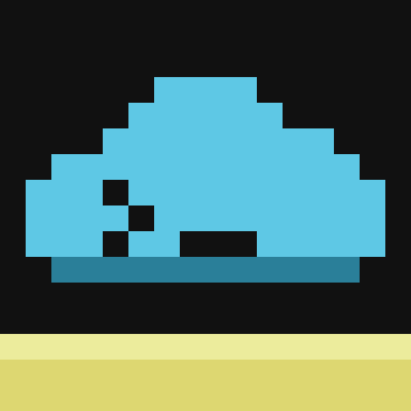

# CC: Cloud

**Control your Minecraft base from any browser.**
A [CC: Tweaked](https://github.com/cc-tweaked/CC-Tweaked) addon that ships its own web dashboard, running inside your Minecraft server.


</div>

<p align="center">
  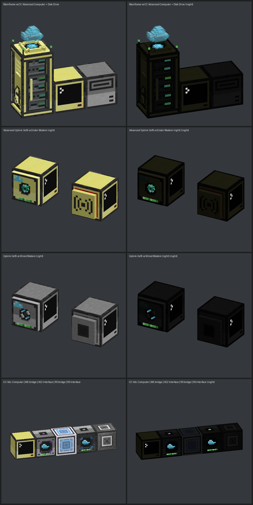
</p>

Build a **Cloud Mainframe**, attach **Uplinks** to your computers and machines, open the dashboard on your phone or PC – and flip switches, watch your reactor, search your ME system or start a craft from anywhere in your home network.

No external service, no account, no relay: the dashboard is served by the mod itself.

## Features

| | |
|---|---|
| 🖥️ **Zero-code cards** | An uplink on a computer shows power and all six redstone sides instantly. An uplink on a machine shows a ready-made card – for [40+ mods](docs/COMPAT.md) of All the Mods 11, plus generic Energy and Tank cards for everything else. |
| 📦 **AE2 & Refined Storage** | ME / RS Cloud Bridges: browse and search the whole network, item details with history, craft previews with missing items, CPUs and jobs, auto-stock rules that craft when stock runs low. |
| 🧩 **Custom dashboards** | A Lua API (`cloud.button`, `cloud.gauge`, `cloud.chart`, pages, groups …) and the `cloud.ui` helper library. Arrange the live cards in the WYSIWYG layout editor – drag, resize, styles, undo. |
| ⚙️ **Automation** | No-code rules (when → if → then) that run on the server, push notifications to Discord, ntfy or webhooks, long-term history charts with CSV export. |
| ⌨️ **For scripters** | A browser terminal for any computer, a Lua editor with highlighting and a file tree, script upload and a community **Script Store** with signed, verified installs. |
| 📡 **Real network** | Ranges, relays, Ender Relays across dimensions, CC cables and fiber, wireless redstone channels, mainframe upgrades up to the Quantum Core, and topology, 2D map and a 3D voxel view of your base. |
| 🔐 **Secure by default** | LAN-only by default, in-game approval for every new browser, roles with fine-grained permissions, PINs for critical controls, LuckPerms / FTB Ranks / FTB Teams support, read-only share links. |
| 🎮 **In-game** | Mainframe and uplink screens in the CC: Tweaked look, the Cloud Tablet and Cloud Display, the Cloud Analyzer overlay, a GuideME handbook, JEI, Jade and JourneyMap support. |
| 🧭 **Docs built in** | Bilingual (EN/DE) documentation at `/docs` on your own dashboard – works offline. |

<p align="center">
  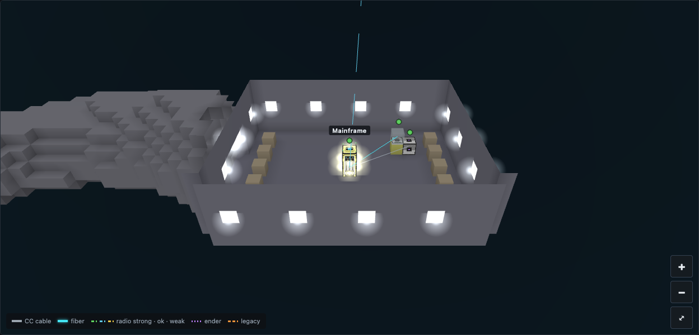
</p>
<p align="center">
  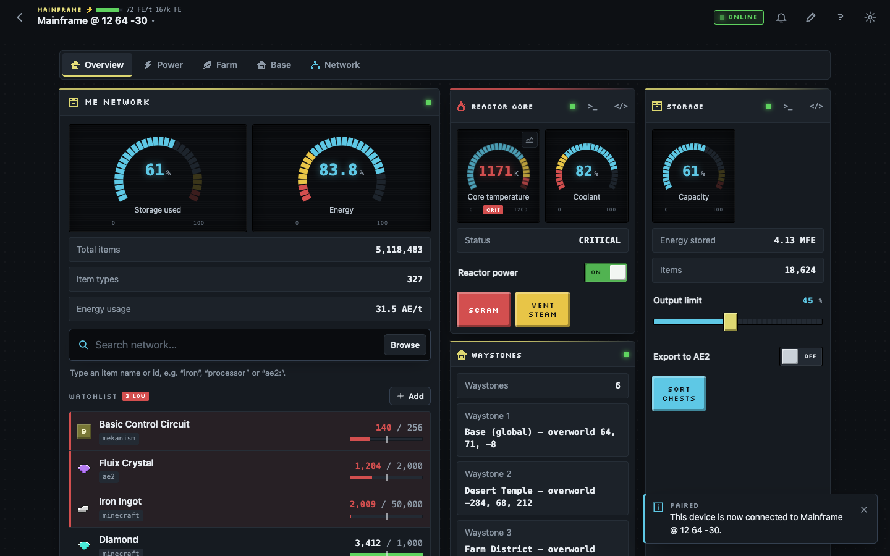
</p>
<p align="center">
  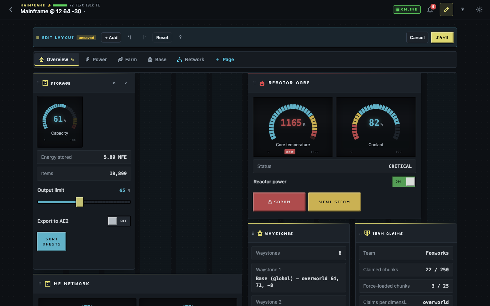
</p>
<p align="center">
  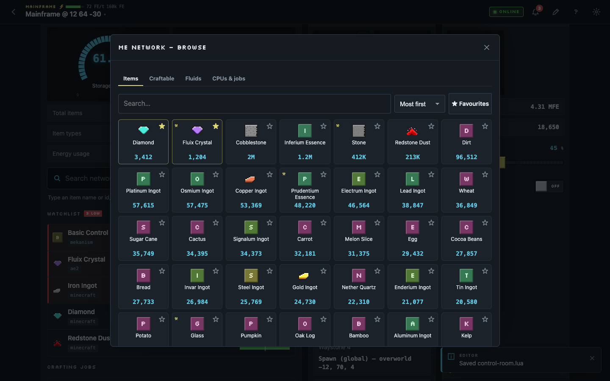
</p>
<p align="center">
  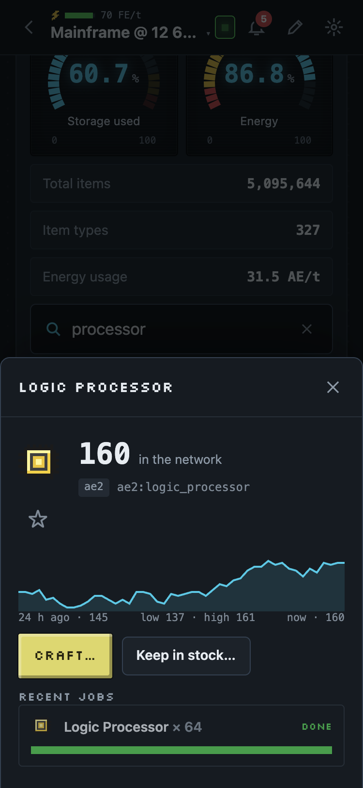
  &nbsp;
  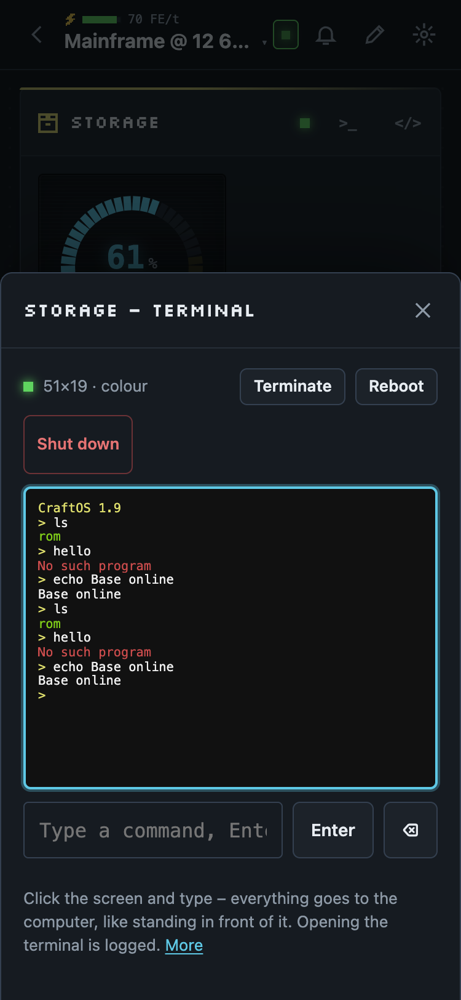
  &nbsp;
  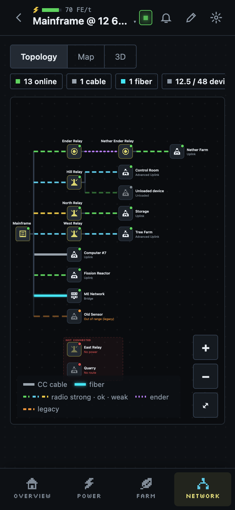
</p>
<p align="center">
  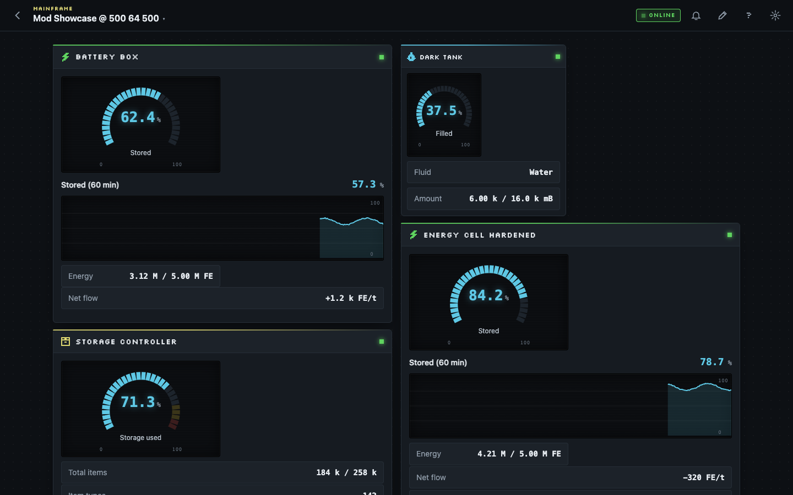
</p>
<p align="center">
  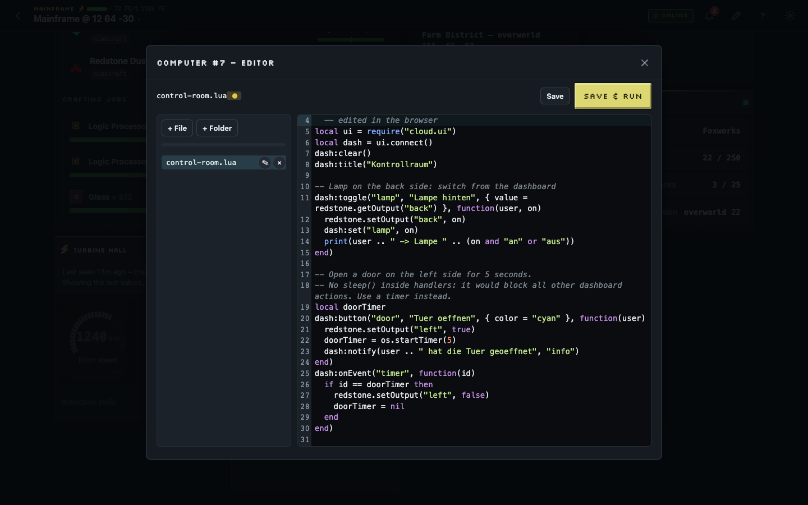
</p>

## Blocks

<p align="center">
  
</p>

| Block | What it does |
|---|---|
| **Cloud Mainframe** | 2 blocks tall. The heart of your network: hosts your dashboard section, needs FE power, has a redstone kill switch and a hologram that tells you its state. |
| **Cloud Uplink / Advanced Cloud Uplink** | Flat plate like a CC modem. Stick it on a computer (Lua or automatic card) or directly on a machine. |
| **ME / RS Cloud Bridge** | Joins your AE2 or Refined Storage network (only registered when the mod is installed). |
| **Cloud Relay / Advanced / Ender Relay** | Extend the range of your network; Ender Relays link dimensions. |

<p align="center">
  
  
  
</p>

## Quick start

1. Install **CC: Tweaked** and **CC: Cloud** (client and server).
2. Place a **Cloud Mainframe** and give it power (any FE source).
3. Place a computer, stick a **Cloud Uplink** on it, and link it with the **Link Card** (right-click the mainframe, then the uplink).
4. Right-click the mainframe: it shows the dashboard address (e.g. `http://192.168.1.20:8787`) and a pairing code.
5. Open the address in your browser, enter the code and click **Allow** in the in-game chat or screen. Done – your computer shows up as a card.

Want your own dashboard? Run `cloud-demo` on the computer, or start from this:

```lua
local ui = require("cloud.ui")
local dash = ui.connect()

local temp = dash:gauge("temp", "Core temperature", { max = 1200, unit = "K", warn = 900, crit = 1100 })
dash:button("scram", "SCRAM", { color = "red", confirm = true, pin = true }, function(user)
  reactor.scram()
  dash:notify(user .. " pressed SCRAM", "crit")
end)

dash:every(1, function() temp:set(reactor.getTemperature()) end)
dash:run()
```

Full reference: `/docs` on your dashboard, or `help cloud` in-game.

## Hosting & security

- The dashboard listens on port **8787** and only accepts **LAN addresses** by default (Tailscale counts as private).
- Internet access is opt-in (`webAllowInternet = true` in `cccloud-server.toml`). Use TLS or a reverse proxy / tunnel – see [`docs/HOSTING.md`](docs/HOSTING.md).
- Every new browser needs in-game approval by a player with the right role. Tokens are hashed, bound to a player and re-checked live (bans, role changes).
- Server permissions via the NeoForge PermissionAPI (`cccloud.*` nodes) – works with LuckPerms and FTB Ranks.
- Threat model and details: [`docs/SECURITY.md`](docs/SECURITY.md) · Report security issues privately, not as public issues.

## Compatibility

- Minecraft **26.1.2**, NeoForge **26.1.2.109+**, CC: Tweaked **1.120.0+**
- Built and tested against **All the Mods 11** (0.12.0-beta) with ~290 mods.
- Optional integrations activate automatically when the mod is present; nothing breaks without them.

## Development

```bash
./gradlew build                     # mod jar in build/libs/
./gradlew runClient                 # dev client
./gradlew runGameTestServer         # GameTests (add -PstorageMods -PintegrationMods for AE2/RS and integrations)
cd cloud && npx pnpm@10 install && npx pnpm@10 dev   # dashboard with a mock server
```

- Mod code: `src/main/java/ai/ezfox/cccloud/`
- Dashboard (Preact PWA): `cloud/web/` – built into `src/main/resources/cccloud_web/`
- Art is generated pixel by pixel: `tools/gen_textures.py`, `tools/gen_models.py`, 3D preview in `preview/viewer.html`
- Spec: [`docs/SPEC.md`](docs/SPEC.md) · Build notes: [`docs/BUILD.md`](docs/BUILD.md) · FTB Quests chapters: [`integration/ftbquests/`](integration/ftbquests/)

## Roadmap

- [x] Mainframe, uplinks, Lua API, dashboard, in-game screens
- [x] AE2 / Refined Storage bridges, item icons, power, storage browser and auto-stock
- [x] Network ranges, relays, topology, 2D map and 3D voxel view
- [x] Roles, accounts, fine-grained permissions, teams, share links
- [x] Mod integrations: energy, machines, farms, quarries, spawners, storage controllers, waystones, quests (40+ mods)
- [x] No-code rules, push notifications (Discord / ntfy / webhooks), browser terminal & Lua editor, long-term history
- [x] Mainframe upgrades (Allthemodium → Unobtainium, Quantum Core, Chunk Anchor), CC cables and fiber, wireless redstone
- [x] Cloud Tablet, Cloud Display, Cloud Analyzer, GuideME handbook, KubeJS bindings
- [x] Script Store with signed index (dashboard side)
- [ ] Public Script Store website with community scripts
- [ ] All the Mods pack submission (see [`docs/ATM_SUBMISSION.md`](docs/ATM_SUBMISSION.md))

## Credits & license

CC: Cloud is licensed under the [Mozilla Public License 2.0](LICENSE). All textures and models are original work.
Built on [CC: Tweaked](https://github.com/cc-tweaked/CC-Tweaked) by SquidDev and contributors – not affiliated with or endorsed by the CC: Tweaked team, Mojang or Microsoft.
